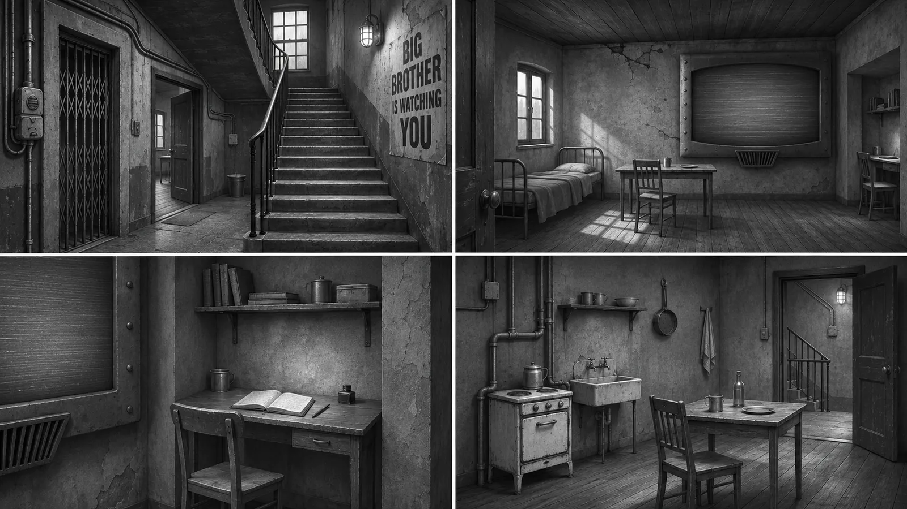

# 1984

Unity project inspired by George Orwell's *1984*, developed for the Virtual
Reality course at Politecnico di Torino — Group 04.

## Synopsis

*1984: The Ministry Simulation (The Censor)* is an educational first-person
experience in which the player is a Ministry of Truth recruit completing a
government training simulation. They inspect stark, mostly monochrome domestic
and bureaucratic spaces with a visual scanner, identify forbidden anomalies
such as an unedited photograph or a diary, and digitally “vaporise” them. Once
an environment has been purged, it fades to black before the next simulation
loads, while impersonal Party evaluations and Newspeak slogans appear. Sparse
lighting, telescreens, cameras, brutalist concrete, and a deliberately empty
world create an anxious atmosphere. By making the player apply the regime’s
rules, the experience uses inverse psychology to expose its mechanisms of
surveillance, censorship, and control.

## A0 working document

The A0 working-document link has not yet been shared with the repository. It
will be added here once the team provides the accessible document URL.

## A1 — Blockout reference

For A1, the team will block out the apartment/interior below, rather than the
introductory gathering. It is a restricted, lived-in domestic space with a
prominent surveillance screen, exposed pipes, worn walls, and an adjoining
stairwell. The environment is inspired by the world of *1984*; its final
narrative owner is intentionally not specified.

